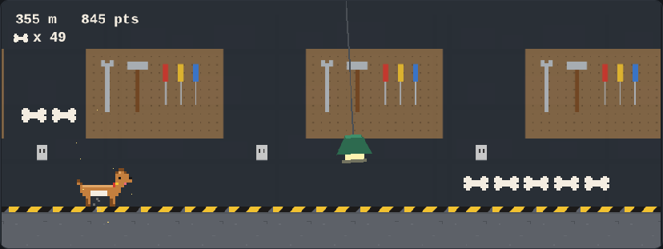
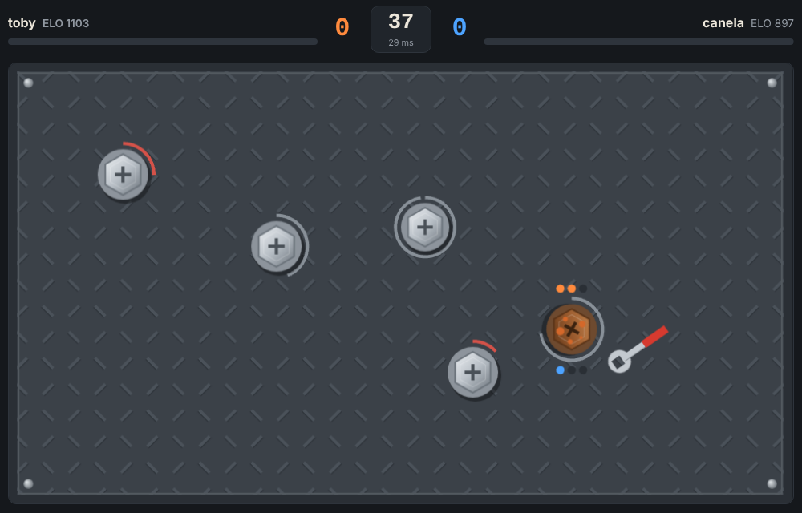
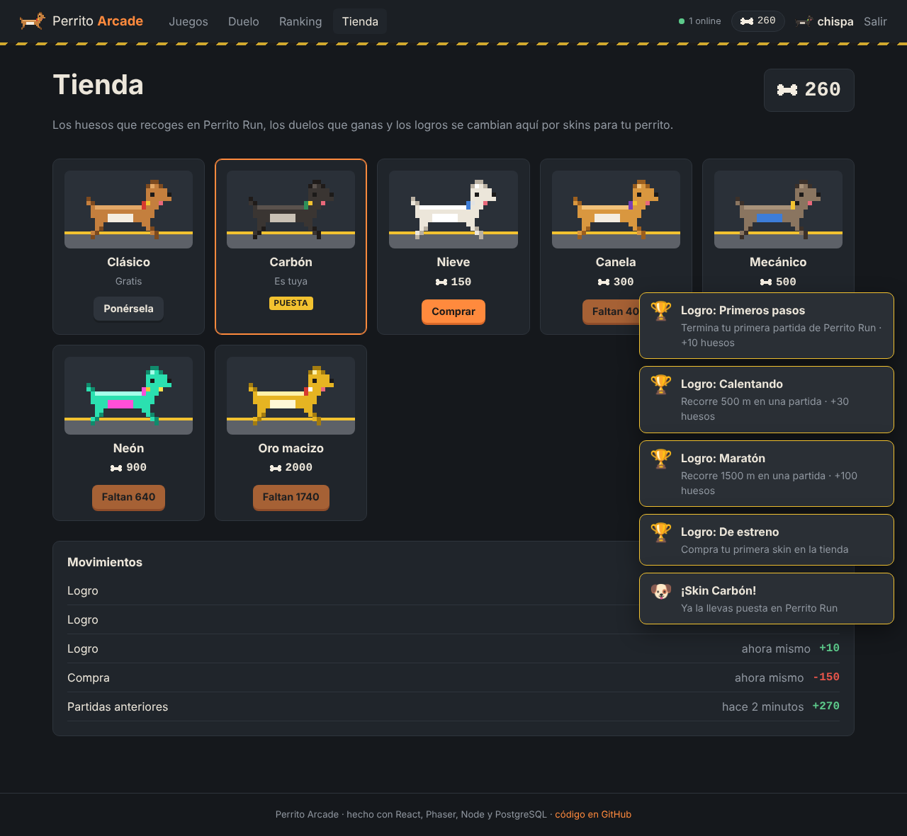

# Perrito Arcade

Plataforma de minijuegos para el navegador con cuentas, ranking en tiempo real y validación de puntuaciones en el servidor. Tiene dos juegos:

- **Perrito Run**: un runner en el que el perro de mi empresa corre por un taller esquivando neumáticos, cajas de herramientas y lámparas.
- **Duelo de Llaves**: multijugador 1 contra 1 en tiempo real. Van saliendo tornillos y el primero que los aprieta se los lleva. Con emparejamiento, salas privadas, ranking ELO y revancha.





Los huesos que recoges, los duelos que ganas y los logros se cambian en la **tienda** por skins para tu perrito, que se ven en el juego, en los rankings y en tu perfil.



La idea es tener en un mismo proyecto las dos cosas a las que me dedico: desarrollo de juegos (el juego en sí, con Phaser) y desarrollo web full stack (la plataforma que hay alrededor: API, base de datos, tiempo real y despliegue).

## Qué hace

- **Perrito Run**: runner 2D con salto variable (si mantienes pulsado saltas más), doble salto, coyote time y jump buffer, dificultad progresiva, partículas, sonido sintetizado y todos los gráficos dibujados por código (no hay ni un PNG).
- **Cuentas** con registro y login (JWT + bcrypt).
- **Las puntuaciones no se las cree el servidor**. El cliente manda lo que pasó en la partida (metros, huesos, duración) y el servidor calcula los puntos y comprueba que son posibles para el tiempo que ha pasado desde que empezó la partida. Si alguien edita la petición y pone 999999, se rechaza.
- **Ranking en directo** con Socket.IO: cuando alguien entra en el top 10, se actualiza en todas las pestañas abiertas. También hay un feed de partidas en la portada y un contador de gente conectada.
- **Ranking semanal y general**, perfil de cada jugador con sus estadísticas.
- **Panel de administración**: partidas por día, porcentaje de partidas rechazadas, motivos y lista de partidas sospechosas.

### Duelo de Llaves (multijugador)

- **El servidor manda**: la partida se simula en el servidor (`server/src/duel/engine.ts`) y los clientes solo dicen "he tocado el tornillo 12". Si los dos lo tocan a la vez, se lo lleva el primero que llega.
- **Sin sensación de lag**: al tocar un tornillo el cliente gira la tuerca, saca chispas y suena al momento; el resultado oficial llega después. Si llegaste tarde, sale un "¡Tarde!".
- **Reloj sincronizado** con el servidor (al estilo NTP) para que la cuenta atrás y los tiempos de los tornillos cuadren aunque el reloj del ordenador vaya mal. Se ve el ping en pantalla.
- **Emparejamiento** por cola, **salas privadas** con código y enlace de invitación, y un **bot** de práctica si no hay nadie.
- **Reconexión**: si se te cae la conexión o recargas la página, tienes 10 segundos para volver a la partida. Si no vuelves, pierdes.
- **Ranking ELO** (las partidas contra el bot no cuentan) y **revancha** cuando los dos la piden.
- **Anti-trampas básico**: no se aceptan toques más rápidos que un humano ni más de 14 por segundo.
- Funciona en el móvil con varios dedos a la vez.

### Tienda, monedero y logros

- **Monedero con libro de movimientos**: cada hueso que entra o sale queda apuntado con su motivo (partida, duelo, logro, compra). El saldo se guarda en el usuario para leerlo rápido y un `CHECK (bones >= 0)` en la base de datos hace imposible quedarse en negativo.
- **Pagos idempotentes**: un índice único sobre (usuario, motivo, referencia) impide que la misma partida o el mismo logro paguen dos veces, aunque se repita la petición.
- **Compras en una transacción**: cobrar, dar la skin, equiparla y revisar logros va todo junto; si falla algo, no pasa nada. Dos compras a la vez de la misma skin: una entra y la otra se rechaza (hay test).
- **7 skins** que son cambios de paleta del sprite del perrito, así que salen gratis de dibujar.
- **8 logros** con recompensa que se comprueban dentro de la misma transacción que los provoca y se avisan al momento por websocket (en todas las pestañas abiertas del jugador).
- Cuando se añadió el monedero, una migración pasó a los jugadores los huesos de las partidas que ya habían jugado.

## Tecnologías

| Parte | Tecnología |
| --- | --- |
| Juego | Phaser 3 (Arcade Physics), WebAudio |
| Frontend | React 19, TypeScript, React Router, Vite |
| Backend | Node.js, Express, TypeScript, Zod |
| Tiempo real | Socket.IO (ranking en directo y el multijugador) |
| Base de datos | PostgreSQL (SQL a mano con `pg`, migraciones propias) |
| Tests | Vitest + Supertest contra una base de datos real, Playwright para los de extremo a extremo |
| Infra | Docker, docker-compose, GitHub Actions |

## Arrancarlo en local

Hace falta Node 22 y Docker (solo para la base de datos).

```bash
# 1. base de datos
docker compose up -d db

# 2. backend
cd server
cp .env.example .env
npm install
npm run migrate
npm run seed        # opcional: jugadores de prueba para que el ranking no salga vacío
npm run dev         # http://localhost:4000

# 3. frontend (en otra terminal)
cd client
npm install
npm run dev         # http://localhost:5173
```

Para tener una cuenta de administrador, regístrate desde la web y luego:

```bash
cd server && npm run make-admin -- tu_usuario
```

### Todo con Docker

```bash
docker compose --profile full up --build
```

Y se abre en http://localhost:4000 (el servidor sirve también el frontend compilado).

## Tests

```bash
cd server && npm test   # 67 tests
cd client && npm test   # tests de la lógica de dificultad del juego
cd e2e && npx playwright test   # 8 tests con navegador real (levantan su propia API y front)
```

Los e2e necesitan una base de datos `arcade_e2e` (la crea `docker compose`). Levantan la API y el front en otros puertos (4010 y 5174), así que se pueden pasar con la app de desarrollo abierta. Cubren registro y login, una partida de Perrito Run con su logro, un duelo entre **dos navegadores a la vez** por sala privada con clics reales sobre el canvas, y una compra en la tienda.

Los tests del servidor van contra PostgreSQL de verdad (la base de datos `arcade_test`, que se borra entera en cada ejecución), no contra mocks. Así se prueban de verdad cosas como que dos peticiones a la vez no puedan cerrar la misma partida.

Los del duelo son de dos tipos:

- **Motor** (`duelEngine.test.ts`): reglas, empates, caducidad, anti-trampas y una partida entera contra el bot, con un reloj y un generador aleatorio con semilla para que siempre den lo mismo.
- **Multijugador** (`duelSocket.test.ts`): levanta el servidor de verdad y conecta varios clientes de Socket.IO. Prueba el emparejamiento, quién se lleva un tornillo disputado, el abandono, la reconexión dentro y fuera de tiempo, las salas privadas, la revancha y que el ELO queda bien guardado.

## Estructura

```
client/
  src/game/          Perrito Run: escena de Phaser, texturas, sonidos, dificultad
  src/game/duel/     Duelo de Llaves: escena y texturas
  src/duel/          estado del duelo en el cliente (hook) y reloj sincronizado
  src/pages/         páginas de React
  src/components/    ranking, feed en directo, envoltorio del juego...
server/
  migrations/        SQL de la base de datos
  src/routes/        endpoints de la API
  src/services/      validación de puntuaciones y ranking
  src/duel/          motor del duelo, emparejamiento, bot, ELO
  src/realtime.ts    Socket.IO
  test/
  src/economy/       monedero y logros
e2e/                 tests con navegador real (Playwright)
docs/
  DEVLOG.md          diario de desarrollo con los problemas que me fui encontrando
  DECISIONES.md      por qué hice las cosas así
```

## API

| Método | Ruta | |
| --- | --- | --- |
| POST | `/api/auth/register` | crear cuenta |
| POST | `/api/auth/login` | entrar |
| GET | `/api/auth/me` | usuario actual |
| GET | `/api/games` | lista de juegos con número de partidas |
| GET | `/api/games/:slug/leaderboard?period=all\|week` | ranking |
| POST | `/api/games/:slug/sessions` | empezar partida (requiere login) |
| POST | `/api/sessions/:id/finish` | terminar partida y validar |
| GET | `/api/users/:username` | perfil y estadísticas |
| GET | `/api/admin/stats` | estadísticas (solo admin) |
| GET | `/api/admin/suspicious` | partidas rechazadas (solo admin) |
| GET | `/api/duels/leaderboard` | ranking ELO del duelo |
| GET | `/api/duels/recent` | últimos duelos |

| GET | `/api/shop` | skins (con cuáles tienes si hay sesión) |
| POST | `/api/shop/:slug/buy` | comprar una skin |
| POST | `/api/shop/:slug/equip` | ponerse una skin |
| GET | `/api/me/wallet` | saldo y últimos movimientos |

El duelo va por Socket.IO. Eventos del cliente (todos con respuesta): `duel:queue`, `duel:cancel`, `duel:bot`, `duel:room:create`, `duel:room:join`, `duel:hit`, `duel:rematch`, `duel:leave`, `duel:sync`, `duel:ping`. Eventos del servidor: `duel:queued`, `duel:match`, `duel:state`, `duel:end`, `duel:opponent`, `duel:rematch-request`.

## Próximos pasos

- [x] **Duelo de Llaves**: multijugador 1 contra 1 con salas y emparejamiento
- [ ] Emparejar por ELO parecido cuando haya más gente en la cola
- [ ] Varias instancias del servidor (adaptador de Redis para Socket.IO y las partidas en Redis)
- [ ] Repeticiones: guardar las pulsaciones de la partida y simularla en el servidor para una validación de verdad
- [x] Skins del perrito que se compran con huesos, y logros
- [ ] Desplegarlo (Railway o Fly.io) con dominio propio

## Licencia

MIT
